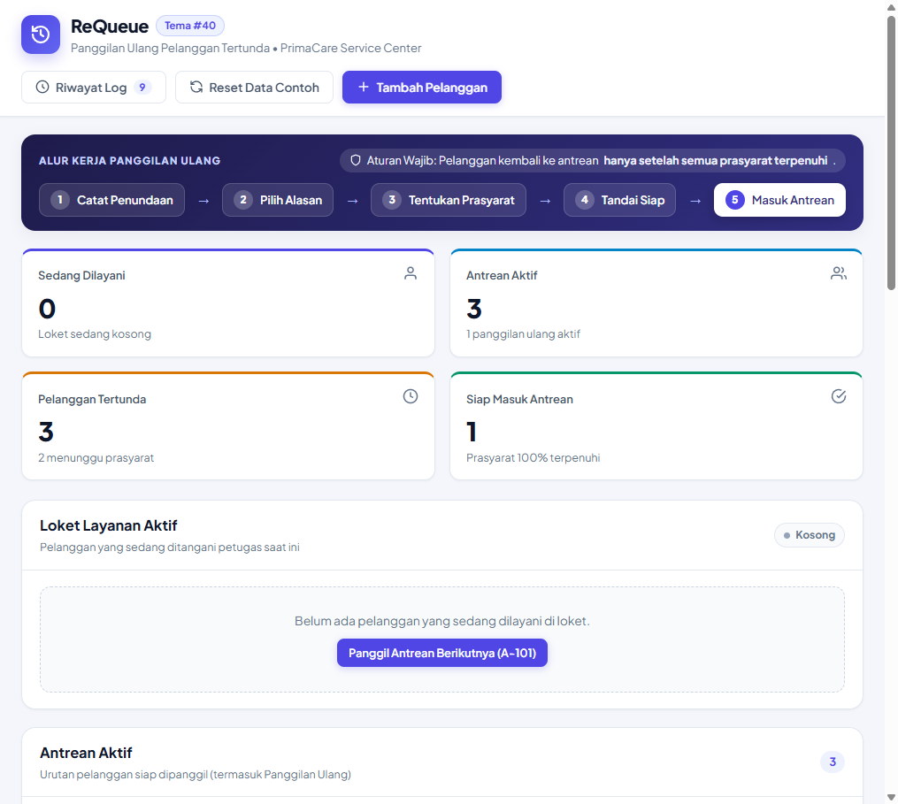

# Bukti Pengujian Aplikasi — ReQueue (Tema 40)

- **Nama:** Teuku Albirza Youza
- **NIM:** 13112510708
- **Nomor Ide / Aplikasi:** 40 — ReQueue (Panggilan Ulang Pelanggan yang Tertunda)
- **Tanggal Uji:** 24 November 2026

---

## Tabel Hasil Pengujian (3 Skenario Wajib)

| No | Skenario Uji | Input / Langkah Pengujian | Hasil yang Diharapkan | Hasil Aktual | Status |
| --- | --- | --- | --- | --- | --- |
| **1** | **Alur Normal (End-to-End)** | 1. Klik **⏸ Tunda Layanan** pada `A-101` (Dimas Pratama) di Loket Aktif. 2. Pilih alasan *"Dokumen / Bukti Pembelian Belum Lengkap"* dan pilih 1 prasyarat (*"Menunjukkan struk / invoice pembelian asli"*), lalu klik **Simpan ke Daftar Tertunda**. 3. Di Papan Pelanggan Tertunda, centang prasyarat `A-101` hingga `1/1 (100%)`. 4. Klik **✓ Tandai Siap**. 5. Klik **↻ Masukkan Kembali ke Antrean** → pilih *Prioritas Panggilan Ulang* → klik **Konfirmasi Masuk Antrean**. | `A-101` berpindah dari Loket Aktif ke Papan Tertunda, status berubah menjadi Siap setelah prasyarat dicentang 100%, lalu kembali masuk ke Antrean Aktif di urutan `#1` dengan label `↻ Panggilan Ulang` dan KPI *Antrean Aktif* bertambah. | `A-101` berpindah ke Papan Tertunda (`0/1`), setelah dicentang menjadi `1/1 (100%)`, berhasil ditandai Siap, dan masuk kembali ke Antrean Aktif urutan `#1 • A-101 Dimas Pratama` berlabel **`↻ Panggilan Ulang`**. KPI *Antrean Aktif* meningkat menjadi `3` (`1 panggilan ulang aktif`) dan pita workflow menyorot langkah **5. Masuk Antrean**. | **LULUS** |
| **2** | **Input Tidak Valid / Tidak Lengkap** | 1. Klik tombol **Catat Penundaan Baru**. 2. Kosongkan Nama Pelanggan, Jenis Layanan, Alasan Penundaan, dan daftar Prasyarat. 3. Langsung klik **Simpan ke Daftar Tertunda**. | Sistem menolak penyimpanan data, modal tetap terbuka, dan menampilkan pesan kesalahan spesifik mengenai kolom yang wajib dilengkapi. | Muncul kotak peringatan validasi (`.alert-error`): *"Nama pelanggan wajib diisi. Jenis layanan wajib dipilih. Alasan penundaan wajib dipilih. Minimal satu prasyarat wajib ditentukan sebelum menyimpan penundaan."* Jumlah data tertunda tetap `3` (tidak tersimpan). | **LULUS** |
| **3** | **Kondisi Batas / Aturan Bisnis (Gerbang Prasyarat)** | 1. Pada Papan Pelanggan Tertunda, pilih kartu `A-104` (Siti Rahmawati) yang baru memenuhi `1/2 (50%)` prasyarat. 2. Klik tombol terkunci **🔒 Masukkan ke Antrean**. | Sistem memblokir aksi pemindahan ke Antrean Aktif karena belum semua prasyarat terpenuhi, menampilkan pesan penolakan yang jelas, dan `A-104` tetap berada di Papan Tertunda. | Muncul toast error merah: *"Ditolak oleh aturan sistem: A-104 belum bisa masuk kembali ke antrean karena 1 prasyarat belum terpenuhi (Menunjukkan kartu garansi resmi)."* Kartu `A-104` tetap berada di Papan Tertunda dan kejadian tercatat di Riwayat Log. | **LULUS** |

---

## Bukti Tangkapan Layar Hasil Pengujian

Tangkapan layar setelah seluruh rangkaian pengujian (termasuk Skenario 1: `A-101` berhasil kembali ke Antrean Aktif sebagai *1 panggilan ulang aktif* dan workflow menyorot Tahap 5 *Masuk Antrean*):

